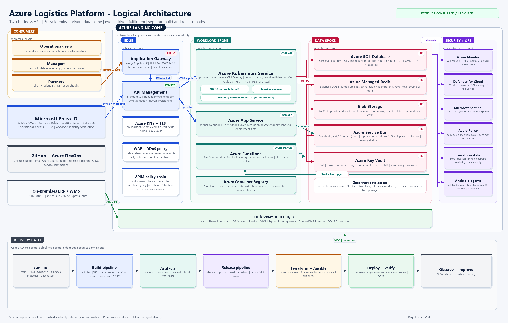
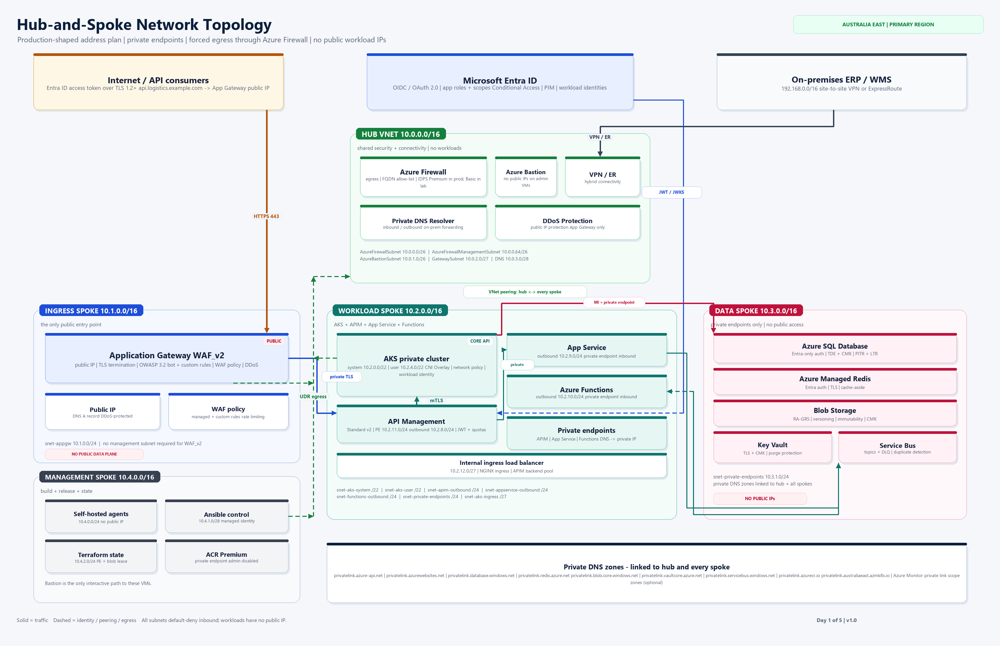

# Azure Logistics Platform

A 5-day, build-from-scratch DevSecOps course that produces a production-shaped logistics API platform on Microsoft Azure.

The business capability is deliberately small: **inventory** and **orders** APIs, authenticated with Microsoft Entra ID, protected by role-based access control, and operated through separate **build** and **release** pipelines in Azure DevOps.

The engineering capability is deliberately realistic: hub-and-spoke networking, private endpoints, WAF, API Management, AKS, App Service, Azure Functions, Service Bus, Azure SQL, Azure Managed Redis, Blob Storage, Key Vault, Terraform, Ansible, policy, observability, and a software supply-chain gate.

> **Current checkpoint: Day 1 of 5.**
> Work through [docs/day-01/README.md](docs/day-01/README.md), complete the end-of-day checklist, then reply **`EOD`** to unlock Day 2.
> Do not deploy Azure resources on Day 1.

---

## What you are building

### The application

One Python/FastAPI codebase with two business route groups:

| Route group | Example endpoints | Purpose |
|---|---|---|
| `/api/v1/inventory` | `GET`, `POST`, `PATCH`, `DELETE` | Stock levels, locations, reservations |
| `/api/v1/orders` | `GET`, `POST`, `PATCH`, `DELETE`, `POST /{id}/cancel` | Customer orders, fulfilment state |

The same codebase is packaged as a container and deployed to **AKS**. A smaller Python service, **partner-webhook**, runs on **App Service** and receives carrier delivery-status callbacks. **Azure Functions** consumes Service Bus events for asynchronous order processing, reconciliation, and audit archiving.

### The security model

- **Authentication** is delegated to Microsoft Entra ID using OIDC/OAuth 2.0. Users and service principals obtain short-lived access tokens.
- **Authorization** is enforced twice: at API Management (JWT validation, scopes/roles, quotas) and inside the API (route policy plus resource ownership).
- **Managers** can delete inventory and orders. **Readers/contributors** have narrower permissions. A user can only read or change their own orders.
- No secrets are stored in code or pipelines. Workloads use managed identities and workload identity federation.
- The data plane has no public network access. App Gateway is the only public application entry point.

### The platform

| Layer | Service | Why |
|---|---|---|
| Edge | Application Gateway WAF_v2, Azure DDoS Protection | Public TLS termination, WAF, bot/rate controls |
| API gateway | Azure API Management Standard v2 | Private inbound endpoint, JWT validation, quotas, versioning |
| Core compute | Azure Kubernetes Service | Private cluster, internal ingress, HPA, network policy, workload identity |
| PaaS compute | Azure Web Apps (App Service) | Partner webhook with slots and private endpoint |
| Event compute | Azure Functions (Flex Consumption) | Service Bus triggers, timer reconciliation, blob audit |
| Transaction data | Azure SQL Database | Relational integrity for inventory and orders |
| Cache | Azure Managed Redis | Cache-aside, idempotency keys, short-lived state |
| Documents | Azure Blob Storage | Inbound documents, audit archive, immutable records |
| Messaging | Azure Service Bus | Topics, subscriptions, dead-letter queues, duplicate detection |
| Secrets/keys | Azure Key Vault | TLS certificates, CMK, last-resort secrets |
| Registry | Azure Container Registry Premium | Private image pulls, scanning, retention |
| Network | Hub-and-spoke VNets, Azure Firewall, Bastion, Private DNS | Segmentation, controlled egress, private resolution |
| Identity | Microsoft Entra ID, managed identities, PIM | Phishing-resistant auth, least privilege, no standing admin |
| IaC | Terraform + remote state in Blob | Repeatable, reviewable infrastructure |
| Configuration | Ansible | Linux/agent hardening and Kubernetes baseline |
| Delivery | GitHub + Azure DevOps | Source, Boards, separate build/release pipelines |
| Observability | Azure Monitor, Log Analytics, Application Insights, Defender, Sentinel | Detect, investigate, respond |

---

## Architecture

### Logical architecture



### Hub-and-spoke network



Editable source for both diagrams: [diagrams/render_diagrams.py](diagrams/render_diagrams.py). Re-render with:

```powershell
python diagrams/render_diagrams.py
```

---

## Repository map

```text
.
├── README.md
├── .github/
│   ├── CODEOWNERS
│   ├── copilot-instructions.md
│   └── pull_request_template.md
├── .vscode/
│   ├── extensions.json
│   └── settings.json
├── app/                         # FastAPI code (built on Day 4)
├── diagrams/
│   ├── logical-architecture.png
│   ├── network-topology.png
│   └── render_diagrams.py
├── docs/
│   ├── day-01/
│   │   ├── DO-THIS-FIRST.md     # minimum path if overwhelmed
│   │   ├── README.md            # full Day 1 workbook
│   │   ├── network-design.md
│   │   ├── identity-and-rbac.md
│   │   ├── zero-trust-threat-model.md
│   │   ├── plan-of-action.md
│   │   ├── glossary.md
│   │   └── azure-boards-import.csv
│   └── adr/                     # Architecture Decision Records
├── infra/
│   ├── ansible/                 # configuration management (Day 3+)
│   └── terraform/               # infrastructure as code (Day 2+)
├── pipelines/                   # build and release YAML (Day 4-5)
├── scripts/
│   ├── check-prereqs.ps1
│   └── check-prereqs.sh
└── tests/                       # API and integration tests (Day 4)
```

---

## The 5-day path

| Day | Outcome | Evidence you can show |
|---|---|---|
| **1** | Architecture, network, identity/RBAC, zero-trust threat model, delivery plan, repo and board | Diagrams, CIDR plan, RBAC matrix, ADRs, GitHub repo, Azure Boards backlog |
| **2** | Bootstrap Terraform state and build the secure hub: Firewall, Bastion, DNS, Log Analytics, Key Vault, policy, identities | Remote state in Blob, hub `terraform plan/apply`, policy assignments |
| **3** | Build spokes and platform services: AKS, App Service, APIM, SQL, Redis, Storage, Service Bus, Functions, ACR, Ansible baseline | Private endpoints, DNS resolution tests, AKS/APIM/App Service deployed, Ansible idempotence |
| **4** | Build the FastAPI app, Entra auth, RBAC, tests, and the **build** pipeline | Green build, unit/integration tests, SAST/dependency/image scans, SBOM, signed image in ACR |
| **5** | Build the **release** pipeline, deploy to dev, gate prod, verify, document, and clean up | Dev deployment, approval-gated prod stage, smoke/DAST results, runbook, cost/cleanup record |

Day 1 is deliberately design-heavy. You cannot safely automate a network and identity model you have not decided yet.

---

## Cost warning

This is a **production-shaped** design, not a free tier lab. Left running in Australia East, the full baseline can cost roughly **USD 2,000-3,500 per month** depending on SKUs, data volumes, log ingestion, Sentinel retention, optional DDoS Network Protection, and whether you use Firewall Premium, APIM Standard v2, App Gateway WAF_v2, AKS node count, and zone redundancy.

A cost-controlled lab profile is documented in [docs/day-01/plan-of-action.md](docs/day-01/plan-of-action.md). Expect roughly **USD 700-1,200 per month** if left running, or **USD 150-300 for the five build days** if you destroy non-production resources nightly. Create a budget and alerts before Day 2. Never leave the full stack running unattended.

---

## Non-negotiable engineering rules

1. **No long-lived secrets.** Use managed identities and workload identity federation. Key Vault is for certificates and third-party secrets only.
2. **Build and release are separate.** Separate pipelines, separate identities, separate permissions, separate approval paths.
3. **Private by default.** No public IP on AKS nodes, App Service, Functions, SQL, Redis, Storage, Key Vault, Service Bus, or ACR. App Gateway is the only application ingress.
4. **Authorize at the resource.** APIM validates the token; the API still enforces role and ownership. Authentication is not authorization.
5. **Everything is code.** Portal changes are exceptions with a documented reason and a follow-up Terraform change.
6. **No secrets in Git.** Secret scanning runs before commit and in the build.
7. **Plan before apply.** Terraform plans are artifacts, reviewed and approved for production.
8. **Least privilege for pipelines.** The build identity can push images; it cannot deploy. The release identity can deploy; it cannot push images.
9. **Observable by default.** Every service emits logs, metrics, and traces with a correlation ID.
10. **Assume breach.** Segment, log, alert, back up, rehearse recovery, and keep a rollback path.
11. **No account identifiers in Git.** Subscription IDs and tenant IDs are not passwords, but they are sensitive metadata. Keep them in local notes or pipeline variable groups, never in tracked documentation.

---

## Start here

1. **If you feel lost, open [DO-THIS-FIRST.md](docs/day-01/DO-THIS-FIRST.md).** It is the minimum, numbered path for Day 1.
2. For the full explanation, open [docs/day-01/README.md](docs/day-01/README.md). Keep [the glossary](docs/day-01/glossary.md) nearby.
3. Block 4.5 hours. Do the steps in order.
4. Capture the evidence listed in the end-of-day checklist.
5. Commit and push your work.
6. Reply **`EOD`** in the chat. Day 2 will be released only after that.

If you get stuck, use the Copilot prompts in the guide. Do not skip the network and RBAC decisions to "save time"; those decisions are the project.
