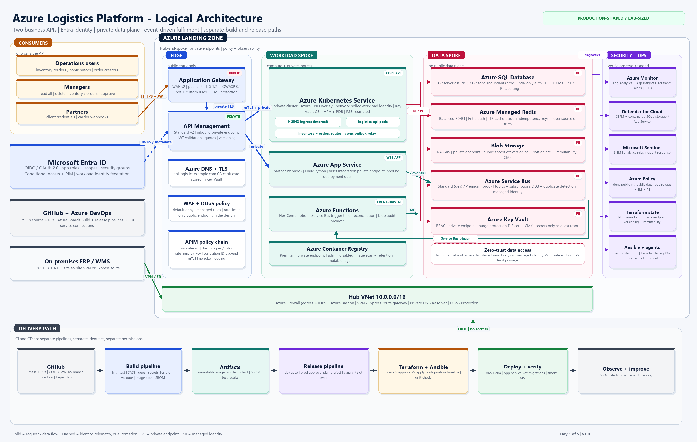
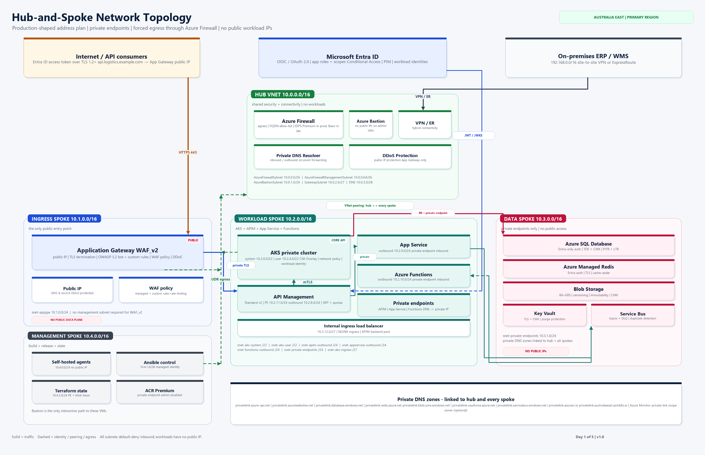

# Day 1 - Architecture, Network, Identity, and the Plan

**Timebox:** 4.5 hours (plus a short buffer)
**Mode:** Design and workstation setup. **Do not create Azure resources today.**
**Outcome:** A reviewed architecture, a defensible network and RBAC design, a threat model, a five-day plan, a GitHub repository, and an Azure Boards backlog.

> **Overwhelmed? Stop reading this page.** Use [DO-THIS-FIRST.md](DO-THIS-FIRST.md) instead. It is the same Day 1 in a simple, numbered, copy-paste order.

The five-day roadmap, cost plan, risks, and fallback path are in [plan-of-action.md](plan-of-action.md). This guide is the Day 1 workbook.

This is the day a DevOps engineer would normally spend before writing Terraform. It feels slow. It prevents the expensive mistakes that usually appear on Day 3: overlapping CIDRs, a subnet that is too small, a public database, an APIM tier that cannot do private networking, or a pipeline identity that is effectively subscription Owner.

New to the vocabulary? Keep [glossary.md](glossary.md) open beside this guide.

If you only remember one sentence:

> **Authentication proves who you are; authorization decides what you may do. The network is not the security boundary; identity, policy, and least privilege are.**

---

## 1. What "done" looks like today

You will produce and commit:

- [ ] A logical architecture diagram with every required Azure component.
- [ ] A hub-and-spoke network diagram with CIDRs and traffic paths.
- [ ] A CIDR/subnet plan with no overlaps and enough address space.
- [ ] An Entra ID app-role and scope model, including manager-only deletes.
- [ ] An endpoint-by-endpoint RBAC matrix.
- [ ] A STRIDE threat model mapped to zero-trust controls.
- [ ] Ten short Architecture Decision Records (ADRs).
- [ ] A five-day plan with outcomes, dependencies, risks, and cost guardrails.
- [ ] A GitHub repository with branch protection and no secrets.
- [ ] An Azure DevOps project with a one-week sprint and an imported backlog.
- [ ] A workstation that passes `scripts/check-prereqs.ps1`.
- [ ] A short list of open questions and assumptions.

You will **not** produce today:

- Terraform resources or `terraform apply`.
- The FastAPI application.
- The build or release YAML.
- Any Azure resource that costs money.

---

## 2. The business and technical contract

### 2.1 Users and capabilities

| Persona | What they do | What they must not do |
|---|---|---|
| Warehouse operator | Read inventory, adjust stock counts | Delete inventory, read all orders |
| Customer service user | Create and update orders, read own orders | Delete orders, change stock levels |
| Logistics manager | Read everything, approve cancellations, delete inventory/orders | Administer the platform |
| Partner carrier | Post delivery-status webhooks for its own shipments | Call inventory or order APIs |
| Platform engineer | Deploy and operate the platform | Read business data without an approved break-glass process |
| Security auditor | Read logs, policies, and configuration | Change data or infrastructure |

### 2.2 Functional requirements

- Two separate API route groups: **inventory** and **orders**.
- OIDC/OAuth 2.0 authentication with Microsoft Entra ID.
- Short-lived access tokens; no API session cookies.
- Role-based authorization at the route level.
- Resource-level authorization for orders: a normal user can only see their own orders.
- Manager role can delete inventory and orders.
- Partner webhook accepts carrier callbacks and publishes an event.
- Order creation publishes an event without losing messages if the database commit succeeds but the broker is unavailable.
- A Function consumes order events and writes an audit record.
- A timer Function reconciles stale reservations.

### 2.3 Non-functional requirements

| Requirement | Target for this course |
|---|---|
| Availability | 99.9% monthly for the API (design target, not a lab SLA) |
| Read latency | p95 < 500 ms at the edge for cached inventory reads |
| Write latency | p95 < 800 ms for order creation |
| Error rate | < 1% 5xx over 5 minutes |
| RPO | 5 minutes for SQL; 15 minutes for blobs |
| RTO | 4 hours for a regional recovery exercise |
| Security | Zero-trust aligned; no public data plane; least privilege |
| Audit | Every change attributable to a human or workload identity |
| Recovery | Rollback within 15 minutes for an application deployment |

These numbers force decisions: relational transactions for inventory/orders, an outbox for events, a cache for reads, and a rollback path for every deployment.

### 2.4 Explicit non-goals for the five days

- Multi-region active-active.
- A full data warehouse or BI layer.
- A customer-facing web or mobile UI.
- A production penetration test.
- 24/7 on-call.
- Migrating a real ERP/WMS.
- Perfect cost optimization.

Write these down. A first DevOps job often fails because the engineer quietly expands scope instead of protecting the delivery date.

---

## 3. The architecture in one page

Open both diagrams side by side:

- [Logical architecture](../../diagrams/logical-architecture.png)
- [Network topology](../../diagrams/network-topology.png)





### 3.1 Request path

```text
User or partner
  -> Microsoft Entra ID (OIDC/OAuth 2.0, MFA, Conditional Access)
  -> access token (JWT)
  -> https://api.logistics.example.com
  -> Application Gateway WAF_v2 (public IP, TLS, WAF, platform DDoS)
  -> API Management Standard v2 (private endpoint, JWT validation, quotas)
  -> AKS internal ingress -> logistics-api pods
       or
  -> App Service private endpoint -> partner-webhook
  -> Azure SQL / Managed Redis / Blob / Service Bus / Key Vault
       all via managed identity + private endpoint
```

### 3.2 Event path

```text
POST /orders
  -> SQL transaction: insert order + insert outbox row
  -> outbox relay publishes order.created to Service Bus
  -> Functions Service Bus trigger
  -> update read model / write audit blob / notify
  -> dead-letter queue after retries
```

The outbox is important. Publishing directly after a database commit creates a dual-write problem: the database can commit and the broker publish can fail. The outbox makes the database the source of truth and the publisher retryable.

### 3.3 Why both AKS and App Service?

A common interview question: "Why not put everything in one compute service?"

- **AKS** hosts the core transactional API because it demonstrates container supply chain, internal ingress, pod-level network policy, workload identity, HPA, and rolling deployments.
- **App Service** hosts the low-volume partner webhook because it demonstrates a managed PaaS path, deployment slots, VNet integration, and private endpoints without adding another cluster.
- **Functions** handles event-driven work that should not run inside the request path.

This is a deliberate split by operational characteristics, not a random tour of Azure services. If you cannot explain why a component exists, remove it.

### 3.4 Component decisions at a glance

| Decision | Choice | Reason |
|---|---|---|
| Identity | Microsoft Entra ID | Native OIDC/OAuth 2.0, app roles, Conditional Access, PIM |
| Public edge | Application Gateway WAF_v2 | WAF, TLS termination, platform DDoS, private backend |
| API gateway | APIM Standard v2 | Private inbound endpoint plus outbound VNet integration; no classic Premium cost |
| Core compute | AKS private cluster | Container portability, network policy, workload identity |
| PaaS compute | Azure Web Apps (App Service) Linux | Low-volume partner webhook, slots, VNet integration |
| Event compute | Functions Flex Consumption | Scale-to-zero event handling, Service Bus trigger |
| Transaction store | Azure SQL Database | ACID transactions, constraints, mature backup/PITR |
| Cache | Azure Managed Redis | Entra auth, private endpoint, low-latency cache |
| Documents | Blob Storage | Cheap durable object store, immutability, lifecycle |
| Messaging | Service Bus | Topics, filters, DLQ, duplicate detection |
| Secrets | Key Vault | RBAC, private endpoint, purge protection, CMK |
| Registry | ACR Premium | Private endpoint, scanning, retention, geo-replication option |
| IaC | Terraform | Plan/apply, modules, remote state, provider ecosystem |
| Configuration | Ansible | Linux/agent hardening, Kubernetes baseline, idempotence |
| CI/CD | Azure DevOps + GitHub | GitHub source/PRs; Azure Boards and pipelines |

### 3.5 The two easy-to-miss architecture constraints

1. **APIM Standard v2 is not the same as APIM Developer/Premium VNet injection.** Standard v2 uses an **inbound private endpoint** and a separate **outbound VNet integration subnet**. It does not inject the whole service into your VNet. This changes the subnet design and the DNS records.
2. **App Service VNet integration is outbound only.** Inbound private access requires a private endpoint. Do not confuse the integration subnet with the private endpoint subnet.

---

## 4. Step 1 - Design the network (60 minutes)

Read the full design: [network-design.md](network-design.md).

### 4.1 Principles

- One **hub** owns shared connectivity and security: firewall, Bastion, VPN/ExpressRoute, Private DNS Resolver.
- Spokes own workloads and data. Spokes do not talk to each other directly unless a rule explicitly allows it.
- All internet egress from workloads goes through Azure Firewall.
- All PaaS data services use private endpoints and private DNS.
- The only public application entry point is Application Gateway.
- Management access uses Azure Bastion, not public SSH.
- Address space is planned once, documented, and never reused.

### 4.2 Address plan

| VNet | CIDR | Purpose |
|---|---|---|
| `vnet-hub` | `10.0.0.0/16` | Shared security and connectivity |
| `vnet-ingress` | `10.1.0.0/16` | Application Gateway WAF |
| `vnet-workload` | `10.2.0.0/16` | AKS, APIM outbound, App Service, Functions, private endpoints |
| `vnet-data` | `10.3.0.0/16` | SQL, Redis, Storage, Key Vault, Service Bus private endpoints |
| `vnet-management` | `10.4.0.0/16` | Self-hosted agents, Ansible control node, Terraform state, ACR |
| Reserved | `10.5.0.0/16` - `10.15.0.0/16` | Future spokes |
| On-premises | `192.168.0.0/16` | ERP/WMS (example; confirm with the network team) |
| AKS pods | `100.64.0.0/16` | Azure CNI Overlay pod CIDR |
| AKS services | `10.60.0.0/16` | Kubernetes service CIDR; must not overlap VNets |

> **Check:** The App Service worker infrastructure can use ranges such as `10.70.0.0/19` and `10.71.0.0/19` for P1v3. Never place a destination subnet in those ranges. Our `10.0.0.0/16` - `10.4.0.0/16` plan avoids them, but confirm the current ranges for your chosen SKU before Day 2.

### 4.3 Subnet plan

#### Hub VNet - `10.0.0.0/16`

| Subnet | CIDR | Purpose | Notes |
|---|---|---|---|
| `AzureFirewallSubnet` | `10.0.0.0/26` | Azure Firewall | Required name |
| `AzureFirewallManagementSubnet` | `10.0.0.64/26` | Forced-tunneling management traffic | Required only for forced tunneling |
| `AzureBastionSubnet` | `10.0.1.0/26` | Azure Bastion | Must be `/26` or larger |
| `GatewaySubnet` | `10.0.2.0/27` | VPN/ExpressRoute | Required name |
| `snet-dns-inbound` | `10.0.3.0/28` | Private DNS Resolver inbound | On-prem forwarding |
| `snet-dns-outbound` | `10.0.3.16/28` | Private DNS Resolver outbound | Conditional forwarding |
| `snet-shared` | `10.0.4.0/24` | Future shared services | Keep empty initially |

#### Ingress VNet - `10.1.0.0/16`

| Subnet | CIDR | Purpose | Notes |
|---|---|---|---|
| `snet-appgw` | `10.1.0.0/24` | Application Gateway WAF_v2 | Dedicated subnet; no other resources |

#### Workload VNet - `10.2.0.0/16`

| Subnet | CIDR | Purpose | Delegation / notes |
|---|---|---|---|
| `snet-aks-system` | `10.2.0.0/22` | AKS system node pool | Node IPs only with CNI Overlay |
| `snet-aks-user` | `10.2.4.0/22` | AKS user node pool | Application workloads |
| `snet-apim-outbound` | `10.2.8.0/24` | APIM outbound VNet integration | Delegate to `Microsoft.Web/serverFarms` |
| `snet-appservice-outbound` | `10.2.9.0/24` | App Service VNet integration | Delegate to `Microsoft.Web/serverFarms` |
| `snet-functions-outbound` | `10.2.10.0/24` | Functions VNet integration | Delegate to `Microsoft.Web/serverFarms` |
| `snet-private-endpoints` | `10.2.11.0/24` | APIM, App Service, Functions private endpoints | No delegation |
| `snet-aks-ingress` | `10.2.12.0/27` | Internal load balancer / ingress | Static internal IP |

#### Data VNet - `10.3.0.0/16`

| Subnet | CIDR | Purpose | Notes |
|---|---|---|---|
| `snet-private-endpoints` | `10.3.1.0/24` | SQL, Redis, Storage, Key Vault, Service Bus private endpoints | No public access on the services |

#### Management VNet - `10.4.0.0/16`

| Subnet | CIDR | Purpose | Notes |
|---|---|---|---|
| `snet-devops-agents` | `10.4.0.0/24` | Self-hosted Azure DevOps agents | No public IP |
| `snet-ansible` | `10.4.1.0/28` | Ansible control node | No public IP; Bastion only |
| `snet-private-endpoints` | `10.4.2.0/24` | Terraform state storage, ACR | Private endpoints |
| Reserved | `10.4.3.0/24` - `10.4.15.0/24` | Future | - |

### 4.4 Routing

| From | Destination | Next hop | Why |
|---|---|---|---|
| All spoke subnets | `0.0.0.0/0` | Azure Firewall private IP (`10.0.0.4`) | Forced egress, FQDN allow-list, IDPS |
| AKS node subnets | `0.0.0.0/0` | Azure Firewall | `outboundType=userDefinedRouting`; no load balancer outbound |
| App Service / Functions integration | `0.0.0.0/0` | Azure Firewall | Route all outbound traffic through inspection |
| App Gateway subnet | `0.0.0.0/0` | Azure Firewall | Certificate/CRL and update egress; backend private traffic uses peering route |
| Hub | On-prem `192.168.0.0/16` | VPN/ExpressRoute gateway | Hybrid access |
| Spokes | On-prem `192.168.0.0/16` | Gateway in hub via peering | `allowGatewayTransit` / `useRemoteGateways` |
| Private endpoint subnets | VNet-local | System route | Private endpoint traffic stays local |

Do **not** route `AzureCloud` service tags through the firewall unless you have a specific reason. Private endpoints and Azure backbone traffic should stay on the Azure network.

### 4.5 Ingress and egress rules

**Ingress**

1. Internet -> App Gateway public IP on 443 only.
2. App Gateway -> APIM private endpoint on 443.
3. APIM -> AKS internal ingress on 443 with mTLS.
4. APIM -> App Service private endpoint on 443.
5. No direct internet path to AKS, App Service, Functions, SQL, Redis, Storage, Key Vault, Service Bus, or ACR.

**Egress**

- AKS: `mcr.microsoft.com`, `*.data.mcr.microsoft.com`, `management.azure.com`, `login.microsoftonline.com`, `packages.microsoft.com`, Ubuntu repositories, ACR, Key Vault, SQL, Redis, Storage, Service Bus, Azure Monitor.
- App Service/Functions: Entra ID, Key Vault, SQL, Redis, Storage, Service Bus, ACR (Functions base image pulls), Azure Monitor.
- Agents/Ansible: Azure DevOps, GitHub, ACR, Azure Resource Manager, Terraform registry, PyPI, Ubuntu repositories, Key Vault, Azure Monitor.
- Deny everything else by default. Log denied flows.

### 4.6 Private DNS zones

| Service | Private DNS zone |
|---|---|
| APIM | `privatelink.azure-api.net` |
| App Service / Functions | `privatelink.azurewebsites.net` |
| Azure SQL | `privatelink.database.windows.net` |
| Azure Managed Redis | `privatelink.redis.azure.net` |
| Blob Storage | `privatelink.blob.core.windows.net` |
| Key Vault | `privatelink.vaultcore.azure.net` |
| Service Bus | `privatelink.servicebus.windows.net` |
| ACR | `privatelink.azurecr.io` |
| AKS API server | `privatelink.australiaeast.azmk8s.io` |
| Azure Monitor (optional private link scope) | `privatelink.monitor.azure.com`, `privatelink.oms.opinsights.azure.com`, `privatelink.ods.opinsights.azure.com`, `privatelink.agentsvc.azure-automation.net` |

Link every zone to the hub and every spoke that needs it. Disable auto-registration. On-premises DNS forwards to the Private DNS Resolver inbound IP.

### 4.7 Network acceptance tests for later

You cannot run these today, but write them down now:

- [ ] `nslookup <sql>.database.windows.net` from an AKS pod returns a `10.3.1.x` address.
- [ ] `nslookup <apim>.azure-api.net` from the App Gateway subnet returns a `10.2.11.x` address.
- [ ] AKS cannot reach the internet directly; traffic appears in firewall logs.
- [ ] App Gateway returns 403 for a blocked WAF payload.
- [ ] APIM returns 401 with no token and 403 with a valid token lacking the role.
- [ ] No public IP exists on AKS nodes, App Service, Functions, SQL, Redis, Storage, Key Vault, Service Bus, or ACR.
- [ ] Public network access is disabled on every PaaS data service.

### 4.8 Exercise: defend the design

Write one paragraph for each question:

1. Why is App Gateway in its own spoke instead of the hub?
2. Why does APIM need two subnets (private endpoint and outbound integration)?
3. What happens to AKS egress if Azure Firewall is unavailable?
4. Why is `10.60.0.0/16` a bad choice for a VNet if you plan to use it as the AKS service CIDR?
5. Which component would you remove first to cut cost, and what security property would you lose?

Copilot prompt:

```text
Act as a senior Azure network engineer. Review this hub-and-spoke CIDR and subnet plan for overlaps, Azure reserved ranges, App Service worker IP ranges, AKS service/pod CIDRs, and subnet sizing. List only concrete problems and recommended fixes. Do not invent resources that are not in the plan.
```

---

## 5. Step 2 - Design identity and authorization (45 minutes)

Read the full design: [identity-and-rbac.md](identity-and-rbac.md).

### 5.1 Separate the two jobs

| Concern | Question | Mechanism |
|---|---|---|
| Authentication | Who are you? | Entra ID OIDC/OAuth 2.0, MFA, Conditional Access |
| Authorization | What may you do? | App roles/scopes, route policy, resource ownership |
| Token | What proof travels? | Short-lived JWT access token |
| Workload identity | What is this service allowed to do? | Managed identity / workload identity federation |
| Admin access | Who can change the platform? | Azure RBAC + PIM, just-in-time |

**Do not:**

- Use an ID token as an API access token.
- Treat "logged in" as "authorized".
- Put authorization logic only in APIM. The API must enforce it too.
- Store JWTs in logs, URLs, or browser local storage for a server-side API.
- Give the API a database owner account.

### 5.2 Entra objects

| Object | Name | Purpose |
|---|---|---|
| API app registration | `logistics-api` | Exposes scopes and app roles; access token audience |
| Client app registration | `logistics-cli` | Interactive user sign-in (authorization code + PKCE) |
| Client app registration | `logistics-partner` | Partner service-to-service client credentials |
| Security group | `grp-log-inventory-readers` | Read inventory |
| Security group | `grp-log-inventory-contributors` | Create/update inventory |
| Security group | `grp-log-order-readers` | Read own orders |
| Security group | `grp-log-order-contributors` | Create/update own orders |
| Security group | `grp-log-managers` | Read all, delete inventory/orders, approve |
| Security group | `grp-log-platform-admins` | PIM-eligible platform administration |
| Security group | `grp-log-security-auditors` | Read-only audit access |

### 5.3 App roles

| App role value | Allowed member types | Capability |
|---|---|---|
| `Inventory.Reader` | Users/Groups, Applications | Read inventory |
| `Inventory.Contributor` | Users/Groups | Read and create/update inventory |
| `Order.Reader` | Users/Groups, Applications | Read own orders; managers read all |
| `Order.Contributor` | Users/Groups | Create/update own orders |
| `Logistics.Manager` | Users/Groups | Read all, delete inventory/orders, approve cancellations |
| `Partner.Webhook` | Applications | Post carrier webhook events only |

### 5.4 Delegated scopes

| Scope | Used by | Note |
|---|---|---|
| `api://logistics-api/Inventory.Read` | Interactive clients | Consentable |
| `api://logistics-api/Inventory.Write` | Interactive clients | Consentable |
| `api://logistics-api/Orders.Read` | Interactive clients | Consentable |
| `api://logistics-api/Orders.Write` | Interactive clients | Consentable |
| `api://logistics-api/.default` | Client credentials | App role assignment decides actual permission |

Scopes request access. Roles decide what the access permits. A token with `Orders.Write` but no `Order.Contributor` role must not create an order.

### 5.5 Endpoint authorization matrix

| Endpoint | Method | Required role | Resource rule |
|---|---|---|---|
| `/health` | GET | Anonymous (internal only) | None |
| `/api/v1/inventory` | GET | `Inventory.Reader` | None |
| `/api/v1/inventory/{sku}` | GET | `Inventory.Reader` | None |
| `/api/v1/inventory` | POST | `Inventory.Contributor` | None |
| `/api/v1/inventory/{sku}` | PATCH | `Inventory.Contributor` | None |
| `/api/v1/inventory/{sku}` | DELETE | `Logistics.Manager` | None |
| `/api/v1/orders` | GET | `Order.Reader` | Own orders only unless manager |
| `/api/v1/orders/{id}` | GET | `Order.Reader` | Own order or manager |
| `/api/v1/orders` | POST | `Order.Contributor` | `customer_id` must match token |
| `/api/v1/orders/{id}` | PATCH | `Order.Contributor` | Own draft order or manager |
| `/api/v1/orders/{id}` | DELETE | `Logistics.Manager` | None |
| `/api/v1/orders/{id}/cancel` | POST | `Order.Contributor` | Own order or manager |
| `/api/v1/partner/webhooks/carrier` | POST | `Partner.Webhook` | Carrier ID must match token |

### 5.6 Manager delete rule

Managers are the only business role allowed to delete inventory and orders. This is intentionally **not** an Azure RBAC permission. It is an application permission because it changes business records, not cloud resources.

- `DELETE /inventory/{sku}` requires `Logistics.Manager`.
- `DELETE /orders/{id}` requires `Logistics.Manager`.
- The manager role is assigned to `grp-log-managers`.
- The API must emit an audit event for every delete: actor `oid`, object ID, before-state hash, timestamp, correlation ID.
- Soft delete is preferred for orders; hard delete only for data-retention requests.

### 5.7 Azure RBAC and least privilege

| Principal | Scope | Role | Notes |
|---|---|---|---|
| Human platform engineer | Subscription | Reader | Permanent baseline |
| Human platform engineer | Platform RG | Contributor | PIM-eligible, time-bound |
| Human platform engineer | Workload RG (prod) | Contributor | PIM-eligible, approval required |
| Security auditor | Subscription | Reader + Log Analytics Reader | No data plane |
| Build identity | ACR | AcrPush | Cannot deploy |
| Release identity (dev) | Workload RG (dev) | Contributor + Role Based Access Control Administrator | Scoped; no subscription Owner |
| Release identity (prod) | Workload RG (prod) | Contributor + Role Based Access Control Administrator | Separate identity; approval gate |
| AKS kubelet identity | ACR | AcrPull | Image pull only |
| AKS API workload identity | SQL DB | `db_datareader`, `db_datawriter` | No `db_owner` |
| Migration identity | SQL DB | `db_ddladmin` | Used only by migration job |
| Functions identity | Service Bus | Azure Service Bus Data Receiver | No manage permission |
| App Service identity | Service Bus | Azure Service Bus Data Sender | No manage permission |
| APIM identity | Key Vault | Key Vault Secrets User | Certificate read only |
| App Gateway identity | Key Vault | Key Vault Secrets User | TLS certificate read only |

**Separation of duties:** the build identity cannot deploy. The release identity cannot push images. A human cannot approve their own production deployment.

### 5.8 Token validation rules

At APIM and again in the API:

- Signature validated against Entra JWKS.
- Issuer equals your tenant's v2 issuer.
- Audience equals `api://logistics-api`.
- `exp` and `nbf` validated with small clock skew.
- `tid` equals your tenant.
- `scp` or `roles` contains the required permission.
- `azp`/`appid` is an approved client for partner flows.
- Token size and header size limited.
- No token in query strings or logs.

Return **401** for missing/invalid authentication. Return **403** for valid authentication but insufficient permission. Never return 404 to hide an authorization failure unless the resource itself must be hidden; document the choice.

### 5.9 Test cases to implement on Day 4

| Test | Expected |
|---|---|
| No token -> GET inventory | 401 |
| Expired token -> GET inventory | 401 |
| Valid token, wrong audience | 401 |
| Reader -> GET inventory | 200 |
| Reader -> DELETE inventory | 403 |
| Contributor -> POST inventory | 201 |
| Contributor -> DELETE inventory | 403 |
| Manager -> DELETE inventory | 204 |
| User A -> GET user B's order | 404 (or 403; be consistent) |
| Manager -> GET any order | 200 |
| Partner token -> GET orders | 403 |
| Partner token -> POST own webhook | 202 |

Copilot prompt:

```text
Review this RBAC matrix as a security reviewer. Identify privilege escalation paths, missing negative tests, and places where authentication and authorization are conflated. Focus on manager deletes, order ownership, partner client credentials, and pipeline identities.
```

---

## 6. Step 3 - Threat model and zero-trust controls (30 minutes)

Read the full model: [zero-trust-threat-model.md](zero-trust-threat-model.md).

### 6.1 Zero-trust in one table

| Pillar | What it means here | Evidence |
|---|---|---|
| Verify explicitly | Entra ID, MFA, Conditional Access, token validation at two layers, mTLS to backends | APIM policy, API dependency, sign-in logs |
| Least privilege | App roles, ownership checks, PIM, scoped pipeline identities, no shared admin | RBAC matrix, role assignments, PIM schedule |
| Assume breach | Segmentation, private endpoints, WAF, IDPS, network policy, anomaly alerts, backups | NSGs, firewall logs, Defender alerts, restore test |
| Encrypt | TLS 1.2+, TDE/CMK, HTTPS to storage, encrypted Service Bus | Config exports, Key Vault keys |
| Observe | Central logs, traces, audit, correlation ID, SLO alerts | App Insights, Log Analytics, Sentinel |
| Automate | Terraform, policy-as-code, pipeline scans, plan approvals | Pipeline runs, policy compliance |

### 6.2 STRIDE summary

| Threat | Example | Primary controls |
|---|---|---|
| Spoofing | Stolen user token; fake partner | Short-lived tokens, CA/MFA, audience validation, mTLS, partner app role |
| Tampering | Modified request or image | WAF, schema validation, signed images, branch protection, plan approval |
| Repudiation | "I did not delete that order" | SQL auditing, immutable audit blob, correlation ID, Sentinel |
| Information disclosure | Public blob or verbose error | Private endpoints, no public access, error scrubbing, CMK |
| Denial of service | API flood or expensive query | WAF rate limit, APIM quota, Redis cache, SQL tuning, autoscale |
| Elevation of privilege | Over-broad pipeline role; container escape | Scoped identities, PIM, pod security, network policy, no privileged pods |

### 6.3 Attack-path exercise

For each path, write the **first** control that stops it and the **detection** that would tell you it happened:

1. A reader steals a manager's laptop and replays a token.
2. A partner obtains a valid token and calls `/orders`.
3. An attacker finds the SQL server name and tries to connect from the internet.
4. A compromised container tries to reach the metadata endpoint and steal a managed identity token.
5. A malicious PR changes the container base image.
6. A release pipeline identity is compromised.
7. A developer accidentally commits a connection string.
8. An attacker floods the API with 100,000 requests per minute.
9. A storage account is accidentally set to public.
10. A manager deletes 10,000 inventory records.

If you cannot name a preventive control and a detective control, the design is incomplete.

---

## 7. Step 4 - Record the decisions (30 minutes)

Read the ADR index: [../adr/README.md](../adr/README.md).

Write or review these ten ADRs:

| ADR | Decision |
|---|---|
| 0001 | Hub-and-spoke network with centralized egress |
| 0002 | APIM Standard v2 with private endpoint and outbound VNet integration |
| 0003 | AKS for core API, App Service for partner webhook |
| 0004 | Azure SQL Database as the transactional store |
| 0005 | Azure Managed Redis for cache and idempotency |
| 0006 | Service Bus + Functions with transactional outbox |
| 0007 | Terraform remote state in Blob with Entra-only auth and locking |
| 0008 | Ansible scope: Linux/agent hardening and Kubernetes baseline |
| 0009 | Separate build and release pipelines with separate identities |
| 0010 | Authentication and authorization are separate concerns |

An ADR is not an essay. It is a decision with consequences. If a decision changes on Day 2, update the ADR; do not let the document drift.

---

## 8. Step 5 - Set up the workstation (60 minutes)

### 8.1 Accounts and access checklist

- [ ] Azure subscription where you can create resource groups, role assignments, and policies.
- [ ] Microsoft Entra tenant. P1 covers Conditional Access; P2 adds PIM and access reviews. If you do not have P1/P2, record the compensating controls.
- [ ] GitHub account and a private repository. Branch protection for private repositories may require GitHub Pro/Team/Enterprise; check your plan before relying on it.
- [ ] Azure DevOps organization, Basic access, and at least one parallel job (Microsoft-hosted minutes or a self-hosted agent).
- [ ] GitHub Copilot access in VS Code.
- [ ] A domain or subdomain for `api.logistics.example.com` (a lab can use a self-signed certificate temporarily).
- [ ] Budget approval. Set a monthly budget and alerts before Day 2.
- [ ] Permission to create service connections and environments in Azure DevOps.
- [ ] Docker Desktop available (Linux containers).
- [ ] WSL2 available for Ansible.

### 8.2 Install the Windows tools

Open PowerShell **as Administrator** and run:

```powershell
winget install --id Git.Git -e --source winget
winget install --id Microsoft.VisualStudioCode -e --source winget
winget install --id Microsoft.AzureCLI -e --source winget
winget install --id Hashicorp.Terraform -e --source winget
winget install --id Kubernetes.kubectl -e --source winget
winget install --id Helm.Helm -e --source winget
winget install --id Docker.DockerDesktop -e --source winget
winget install --id GitHub.cli -e --source winget
winget install --id Python.Python.3.12 -e --source winget
winget install --id astral-sh.uv -e --source winget
winget install --id aquasecurity.trivy -e --source winget
winget install --id terraform-linters.tflint -e --source winget
winget install --id gitleaks.gitleaks -e --source winget
```

Install the Python-based tools with `pipx` (install `pipx` first if needed):

```powershell
python -m pip install --user pipx
python -m pipx ensurepath
pipx install checkov
pipx install pre-commit
pipx install yamllint
```

Close and reopen PowerShell so the PATH changes take effect.

### 8.3 Install Ansible in WSL2

Ansible does not run as a control node on Windows. Use WSL2 Ubuntu or a Linux VM. For this course, WSL2 is enough.

```powershell
wsl --install -d Ubuntu-24.04
wsl --set-default-version 2
```

Restart if prompted, open Ubuntu, create your UNIX user, then:

```bash
sudo apt update
sudo apt install -y python3-venv pipx openssh-client git curl unzip
pipx ensurepath
pipx install ansible-core
ansible-galaxy collection install azure.azcollection kubernetes.core
ansible --version
```

If `ansible` is not found, close and reopen the WSL terminal. Do not install Ansible with `sudo pip`; it creates a dependency mess.

### 8.4 Verify the workstation

From the repository root in PowerShell:

```powershell
Set-ExecutionPolicy -Scope Process -ExecutionPolicy Bypass
.\scripts\check-prereqs.ps1
```

Then in WSL:

```bash
cd /mnt/c/Users/<you>/Documents/azure-logistics-platform
./scripts/check-prereqs.sh
```

The exact paths differ on your machine. The point is not a perfect version match; it is to find missing tools before Day 2.

### 8.5 VS Code extensions and settings

The repository already contains:

- `.vscode/extensions.json`
- `.vscode/settings.json`
- `.github/copilot-instructions.md`

Install the recommended extensions from the VS Code Extensions view, or run:

```powershell
code --install-extension ms-python.python
code --install-extension ms-python.vscode-pylance
code --install-extension ms-python.debugpy
code --install-extension github.copilot
code --install-extension github.copilot-chat
code --install-extension hashicorp.terraform
code --install-extension redhat.ansible
code --install-extension ms-kubernetes-tools.vscode-kubernetes-tools
code --install-extension ms-azuretools.vscode-docker
code --install-extension ms-vscode.azurecli
code --install-extension ms-vscode.azure-account
code --install-extension eamodio.gitlens
code --install-extension redhat.vscode-yaml
code --install-extension davidanson.vscode-markdownlint
code --install-extension humao.rest-client
code --install-extension editorconfig.editorconfig
code --install-extension sonarsource.sonarlint-vscode
code --install-extension bierner.markdown-mermaid
code --install-extension ms-vscode-remote.remote-wsl
```

Open the repository in VS Code:

```powershell
code .
```

### 8.6 Sign in to Azure and check permissions

```powershell
az login
az account list --output table
az account set --subscription "<your-subscription-id>"
az account show --output jsonc
```

Check your role assignments:

```powershell
$me = az ad signed-in-user show --query id -o tsv
az role assignment list --assignee $me --all --output table
```

Check resource provider registration (optional but useful before Day 2):

```powershell
$providers = @(
  "Microsoft.Network",
  "Microsoft.Compute",
  "Microsoft.ContainerService",
  "Microsoft.ContainerRegistry",
  "Microsoft.Web",
  "Microsoft.ApiManagement",
  "Microsoft.Sql",
  "Microsoft.Cache",
  "Microsoft.Storage",
  "Microsoft.KeyVault",
  "Microsoft.ServiceBus",
  "Microsoft.Insights",
  "Microsoft.OperationalInsights",
  "Microsoft.ManagedIdentity",
  "Microsoft.Authorization",
  "Microsoft.PolicyInsights"
)
foreach ($ns in $providers) {
  az provider register --namespace $ns --wait
}
```

Check regional quota for AKS and App Service:

```powershell
az vm list-usage --location australiaeast --output table
az appservice list-locations --linux-workers-enabled --output table
```

If you do not have quota, request it now. Quota waits are a classic cause of a lost Day 3.

### 8.7 Create the GitHub repository

If you are using this scaffold, initialize Git in the project folder and scan **before** the first commit:

```powershell
git init -b main
git config user.name "Your Name"
git config user.email "you@example.com"
git add .

# Scan the working tree before creating history.
gitleaks detect --source . --verbose --redact --no-git

# Install the hooks, then run all checks against the staged files.
pre-commit install
pre-commit run --all-files

git commit -m "docs(day-1): architecture, network, identity, and delivery plan"
```

Create the private repository and push:

```powershell
gh auth login
gh repo create azure-logistics-platform --private --source . --remote origin --push
```

Then configure branch protection in GitHub:

1. Repository -> **Settings** -> **Branches** -> **Add branch protection rule**.
2. Branch name pattern: `main`.
3. Enable **Require a pull request before merging**.
4. Require **1 approval**.
5. Enable **Dismiss stale pull request approvals when new commits are pushed**.
6. Enable **Require conversation resolution before merging**.
7. Enable **Do not allow bypassing the above settings**.
8. Block force pushes and deletions.
9. Leave required status checks empty for now; add the Azure DevOps build check on Day 4.

Verify:

```powershell
git status
git log --oneline -3
gh repo view --web
```

**Stop before committing if `gitleaks` finds anything.** The repository should contain no subscription IDs, tenant IDs, connection strings, PATs, or certificates.

After the first commit, scan history as well:

```powershell
gitleaks detect --source . --verbose --redact
```

If a hook fails because a tool is not installed, fix the tool or document the exception. Do not disable the hook silently.

### 8.8 Create the Azure DevOps project and backlog

1. Sign in to `https://dev.azure.com/<your-org>`.
2. Create a project:
   - Name: `azure-logistics-platform`
   - Visibility: Private
   - Version control: Git (you will still use GitHub as the source of truth)
   - Work item process: **Agile**.
3. Create an area path `Logistics`.
4. Create an iteration `Sprint 1` covering the five working days.
5. Open **Boards** -> **Queries** -> **Import work items**.
6. Import [azure-boards-import.csv](azure-boards-import.csv). If your project name or area/iteration path differs, edit the last two CSV columns first. Ignore any field that is not valid for a work item type during the import mapping.
7. If parent links are not imported, link the epics/features/stories manually. The CSV is a starting point, not a perfect migration tool.
8. Add the board columns: `New`, `Active`, `Review`, `Done`.
9. Set WIP limits: `Active` = 3, `Review` = 2.
10. Create a one-week sprint and add the Day 1 stories.

Do **not** create service connections or pipelines today. You do not yet have the identities or permissions model to do it safely. That is Day 4 work.

### 8.9 Use Copilot as a reviewer, not an author

Copilot is useful for critique and boilerplate. It is not the decision-maker, and it does not know your tenant, quota, or security exceptions. Use it in the VS Code Chat view with the repository open.

Good prompts:

```text
Review this CIDR and subnet table as a senior Azure network engineer. Find overlaps, Azure-reserved ranges, App Service worker ranges, AKS service/pod CIDRs, and subnet sizing problems. List only concrete issues and fixes.
```

```text
Write an ADR for choosing Azure SQL over Cosmos DB for inventory and orders. Include context, decision, positive and negative consequences, two alternatives, and a review trigger. Do not invent benchmarks.
```

```text
Act as a security reviewer. Review this endpoint-to-role matrix for privilege escalation, missing ownership checks, and missing negative tests. Focus on manager deletes, partner client credentials, and pipeline identities.
```

```text
Generate pytest cases for these authorization rules: no token, expired token, wrong audience, reader delete, contributor delete, manager delete, user A reads user B's order, partner calls orders. Use parametrization and clear expected status codes.
```

```text
Draft a Terraform module skeleton for a private AKS cluster with Azure CNI Overlay, workload identity, network policy, and an internal ingress subnet. Include variables, outputs, and provider version constraints. Do not include secrets.
```

```text
Review this Azure Pipelines YAML for secret exposure, over-privileged tasks, unpinned dependencies, and missing security gates. Assume the build identity must not be able to deploy.
```

Rules for using Copilot:

- Never paste secrets, tenant IDs, subscription IDs, customer data, or full logs with tokens.
- Ask for assumptions and failure modes, not just code.
- Verify every Azure SKU/feature claim against Microsoft Learn; Copilot can be confidently wrong.
- Treat generated code as a draft. Run tests, linters, and a security review.
- Keep the decision and the reason in the ADR, even if Copilot wrote the first draft.

---

## 9. Step 6 - Review, commit, and capture evidence (15 minutes)

### 9.1 Architecture review questions

Answer these in the PR description or in [review-notes.md](review-notes.md):

1. What is the only public application entry point?
2. Which subnet does APIM use for inbound, and which for outbound?
3. Where does AKS get its egress, and what happens if the firewall is down?
4. Which identity reads the TLS certificate for App Gateway?
5. Which identity writes the order event to Service Bus?
6. Which role can delete an order, and where is that enforced?
7. What stops a reader from reading another user's order?
8. Where is the Terraform state stored, and who can read it?
9. What is the rollback plan for a bad API deployment?
10. What would you monitor to know the API is unhealthy before users call the help desk?

### 9.2 Evidence to capture

Create a folder `docs/day-01/evidence/` (do not commit screenshots containing tenant IDs or secrets) and capture:

- Screenshot of the logical diagram.
- Screenshot of the network diagram.
- Screenshot of the GitHub branch protection rule.
- Screenshot of the Azure Boards sprint.
- Output of `scripts/check-prereqs.ps1`.
- Output of `gitleaks detect`.
- A one-paragraph cost estimate.

### 9.3 Final commit

```powershell
python scripts/validate_repo.py
git add .
git commit -m "docs(day-1): complete architecture, network, RBAC, and plan"
git tag -a day-1 -m "Day 1 checkpoint: architecture and delivery plan"
git push origin main --tags
```

---

## 10. Common first-job mistakes to avoid

| Mistake | Consequence | Fix |
|---|---|---|
| Picking CIDRs in a spreadsheet without checking App Service/AKS ranges | Silent routing failures on Day 3 | Validate against current Azure docs and `az` outputs |
| Using APIM Developer/Premium assumptions with Standard v2 | Subnet and DNS design is wrong | Read the tier's networking model before Terraform |
| Putting App Service integration subnet and private endpoint in one subnet | Inbound/outbound confusion; hard to troubleshoot | Separate subnets |
| Making the API public "just for testing" | Data exposure and a bad habit | Use App Gateway + WAF from the start; use a hosts file for local tests |
| Giving the pipeline `Owner` at subscription scope | One compromised pipeline owns everything | Scoped custom roles, separate identities, approvals |
| Using a PAT for Azure service connections | Long-lived secret sprawl | Workload identity federation |
| Storing Terraform state locally | No locking, no team workflow, easy loss | Remote Blob backend with Entra auth and lease locking |
| Treating APIM JWT validation as the only authorization | Any backend path bypasses roles | Enforce in the API as well |
| Logging full tokens or request bodies | Credential and PII leakage | Redact headers, log correlation ID only |
| Building all five days before testing the first vertical slice | Late discovery of a broken design | Day 3 proves connectivity; Day 4 proves one endpoint end to end |
| Forgetting cost | Surprise bill | Budget, alerts, lab profile, nightly destroy |

---

## 11. End-of-day checklist

Do not start Day 2 until all of these are true:

- [ ] I can explain the request path and event path without reading the diagram.
- [ ] The CIDR plan has no overlaps with VNets, on-prem, AKS services/pods, or App Service worker ranges.
- [ ] Every subnet has a purpose, a CIDR, and an owner.
- [ ] The RBAC matrix includes manager-only deletes and own-order access.
- [ ] Authentication and authorization are described separately.
- [ ] At least 10 STRIDE threats have preventive and detective controls.
- [ ] Ten ADRs exist and are marked Accepted or Proposed.
- [ ] The GitHub repo is pushed and `main` is protected.
- [ ] `gitleaks` is clean.
- [ ] The Azure DevOps project, Sprint 1, and backlog exist.
- [ ] A cost estimate and budget plan exist.
- [ ] I have not run `terraform apply`.
- [ ] I have not created any billable Azure resources.

When all boxes are checked, reply with exactly:

```text
EOD
```

Day 2 will start with the Terraform state bootstrap and the hub network. Do not jump ahead: the state backend and identity model are prerequisites for everything else.
